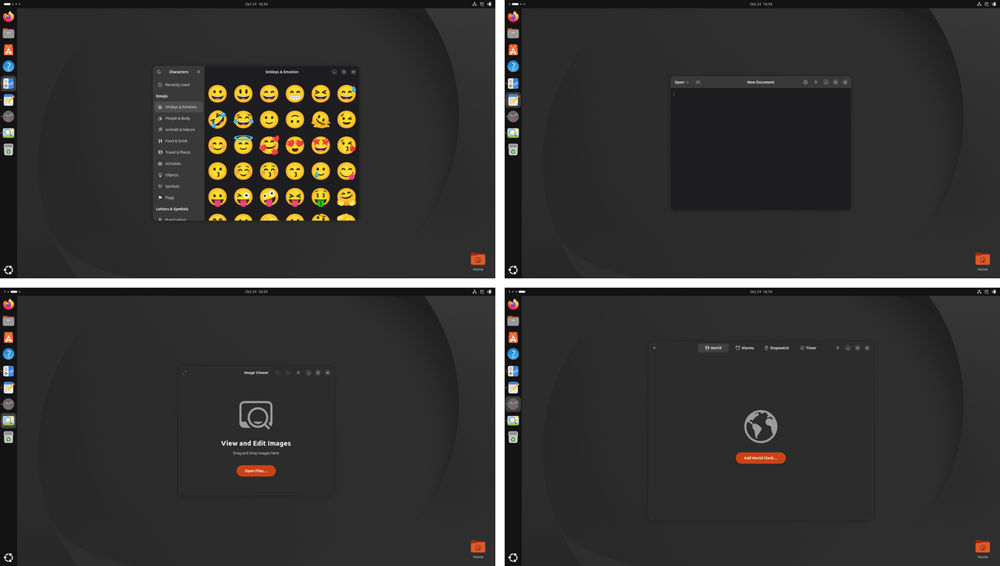
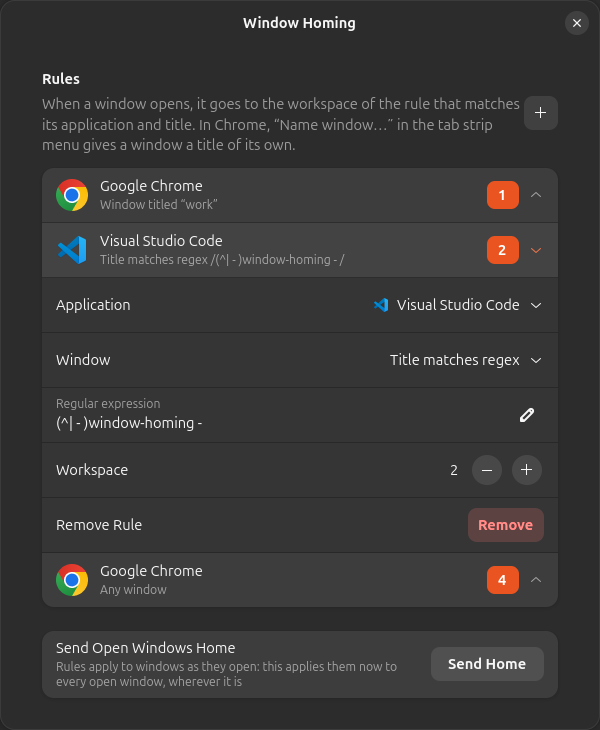

# Window Homing

Window Homing sends every window back to its own workspace, like a homing pigeon:
the browser window you use for work to the first, the editor with a given project
to the second, following rules you write.

I keep the same windows on the same workspaces every day, and after each login I
used to put them back by hand. Auto Move Windows does it per application, so all
the windows of a browser, or of an editor, land on the same workspace. I wanted it
per window, so I wrote this.



A rule matches the application and, if you want, the window title: the title is
exactly some text, contains it, or matches a regular expression. In Chrome, "Name
window…" in the tab strip menu gives a window a name that becomes its whole title,
and Chrome keeps it across restarts; VS Code puts the project folder in its title,
after the open file if there is one, so `(^| - )my-project - ` finds it either
way. A window is moved when it opens, or in the next few seconds if its final
title comes late, so the windows restored at login go home too; move one by hand
later and it stays where you put it. A window moved out of sight comes with
a notification; click it to go to the window. Works with GNOME Shell 46 to 50.

## Installation

```sh
git clone https://github.com/amsis/gnome-shell-extension-window-homing.git
cd gnome-shell-extension-window-homing
glib-compile-schemas schemas/
mkdir -p ~/.local/share/gnome-shell/extensions
ln -s "$PWD" ~/.local/share/gnome-shell/extensions/window-homing@amsis.github.io
```

Log out and back in, then `gnome-extensions enable window-homing@amsis.github.io`.

## Rules

`gnome-extensions prefs window-homing@amsis.github.io` opens the settings: + adds a
rule, click a rule to choose the application, the title and the workspace. "Send
Home" applies the rules to the windows already open.



Or from the terminal:

```sh
gsettings --schemadir ~/.local/share/gnome-shell/extensions/window-homing@amsis.github.io/schemas \
  set org.gnome.shell.extensions.window-homing rules \
  "[('google-chrome.desktop', 'is', 'work', 1), ('com.microsoft.VSCode.desktop', 'matches', '(^| - )my-project - ', 2)]"
```

The application is its desktop file, the "app" Looking Glass shows (or the window
class, for windows GNOME matches to no application); the match is `any`, `is`,
`contains` or `matches`, ignoring case. When several rules fit a window, `is` wins
over `matches`, then `contains`, then `any`.

## License

Written by amsis, released under GPL-2.0-or-later (see [LICENSE](LICENSE)). It will
follow new GNOME versions; pull requests are welcome.
